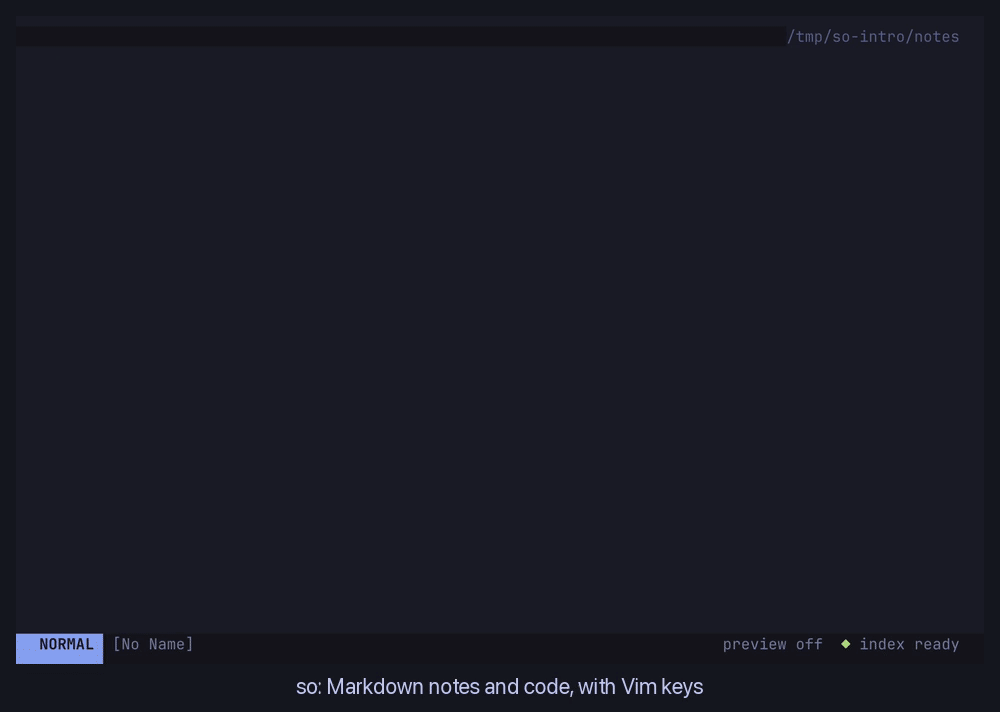

# so

A fast terminal editor with Vim keys, for Markdown notes and code. Notes get Obsidian-style links, views, and Bases; code files get language-server features.



```sh
so [path]
```

## Features

- **Notes** — wiki links, backlinks, link-safe renames, pickers, and full-text search, backed by a background index so typing never blocks.
- **Three views** — read-only `reading`, Obsidian-style `live` (rendered blocks, source on the cursor line), and `source`; images, embeds, math, and Mermaid draw in the terminal.
- **Browser preview** — `:Preview` mirrors the active note on `127.0.0.1`.
- **Daily notes and templates** — Obsidian-compatible; never overwrite an existing file.
- **Bases** — Obsidian `.base` files open as table and Kanban views that write back to frontmatter.
- **PDFs** — read, search, and zoom PDFs in the terminal; select text with the mouse to copy, highlight, or add a note; list your highlights and notes (`<leader>pa`); embed a page in a note (`![[paper.pdf#page=3]]`). Needs [Poppler](https://poppler.freedesktop.org) (`brew install poppler`).
- **Git** — change column, blame, hunk stage/reset, and a lazygit handoff (`<leader>gg`).
- **Code intelligence** — language servers for diagnostics, hover, go-to, rename, code actions, formatting, and completion.
- **Mouse** — works on every surface, always running the same path as a keyboard action.

## Getting Started

Requires [Bun](https://bun.sh) `1.4.2`.

```sh
bun install --frozen-lockfile
bun run dev [path]          # run from source
bun run sandbox             # try it on a demo vault with isolated config
bun run build               # compile to dist/so
```

Config lives at `~/.config/so/config.toml` (or `$XDG_CONFIG_HOME/so/config.toml`); `:Settings` changes common options in place.
