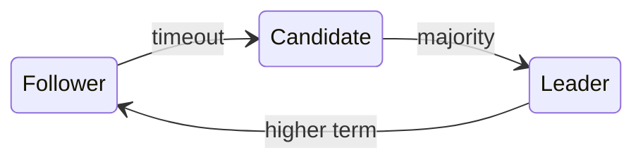

# Raft

Raft splits consensus into [[Leader election]], [[Log replication]], and safety. A follower that hears no heartbeat before its timeout starts an election:

$$
T_{timeout} \sim U(150, 300) ms
$$

> [!tip] Why random?
> Spread-out timeouts make split votes rare, so one candidate usually wins.

![[consensus.pdf#page=1]]
