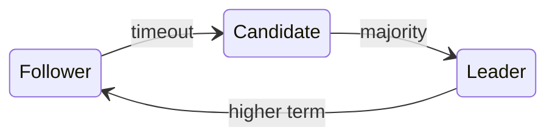

# Raft

Raft splits consensus into [[Leader election]], [[Log replication|replication]], and ==safety==. A follower that hears no heartbeat[^1] before its timeout starts an election. #consensus #papers/2014

$$
T_{timeout} \sim U(150, 300) ms
$$



> [!tip] Why random?
> Spread-out timeouts make split votes rare, so one candidate usually wins.

## Guarantees

| Property | Holds because | § |
|:---|:---|:---:|
| Election safety | one vote per server per term | 5.2 |
| Log matching | same index and term, same entries | 5.3 |
| Leader completeness | votes go only to up-to-date logs | 5.4 |

> [!warning] Commit rule
> A leader counts replicas only for entries from its **own** term.

## Reading list

- [x] Read section 5.2 of [[consensus.pdf]]
- [x] Compare with [[Paxos]] and [[Viewstamped replication]]
- [ ] Run the simulator in `raft-sim`

```rust
pub fn election_timeout(seed: u64) -> Duration {
    Duration::from_millis(150 + seed % 150)
}
```

![[lakeside.png]]

%%Ask about joint consensus for membership changes.%%

![[consensus.pdf#page=1]]

[^1]: An AppendEntries call with no entries.
