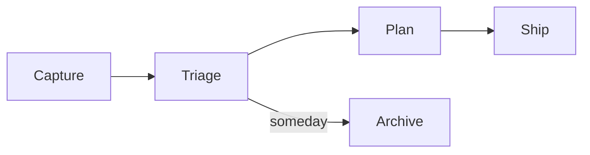

# Markdown tour

Text can be **bold**, *italic*, ~~struck~~, ==highlighted== or `inline code`.
Links show their text: [OpenTUI docs](https://opentui.com), [[so-roadmap|the roadmap]], and [[missing-note]].
Tags like #reference and #so/ui are coloured. A footnote[^1] stays small.

%%This comment is hidden in live preview.%%

## Lists and tasks

- Plain bullet
  - Nested bullet
1. First step
2. Second step
- [ ] Toggle me with Enter
- [x] Already done

## Quotes and callouts

> Simplicity is prerequisite for reliability. — Dijkstra

> [!note] Reveal rule
> Inline syntax shows on the cursor line; whole blocks show while the cursor is inside.

> [!tip]- Folded tip (za to open)
> Callouts with a minus sign start folded.

> [!danger] Data safety
> Saves are atomic: temp file, fsync, rename.

### Table

| Key | Action | Mode |
|:---|:---|:---:|
| `gd` | Follow link | normal |
| `Space f f` | Find file | normal |
| `Ctrl-o` | Jump back | normal |

#### Code

```ts
// one-way data flow
export function update(state: AppState, action: Action) {
  const next = reduce(state, action);
  return { state: next, effects: [] };
}
```

## Embeds and images

![[so-roadmap#Goals]]

![[diagram.png]]

## Math and diagrams

Inline math $E = mc^2$ renders as text.

$$
\sum_{i=1}^{n} x_i \le \frac{a}{b}
$$



---

[^1]: Footnotes render at the bottom, dimmed.
